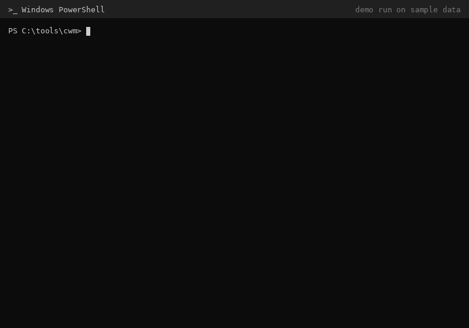
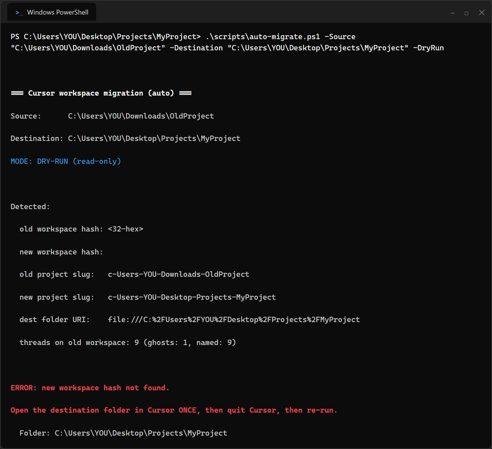
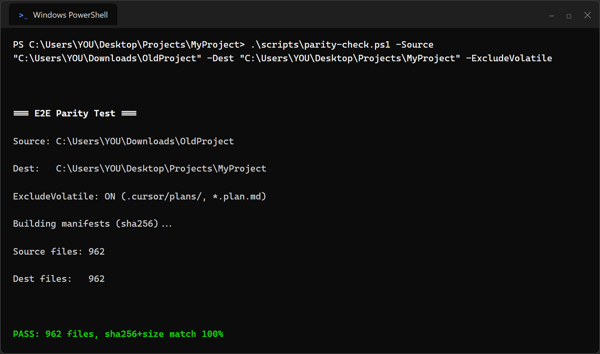
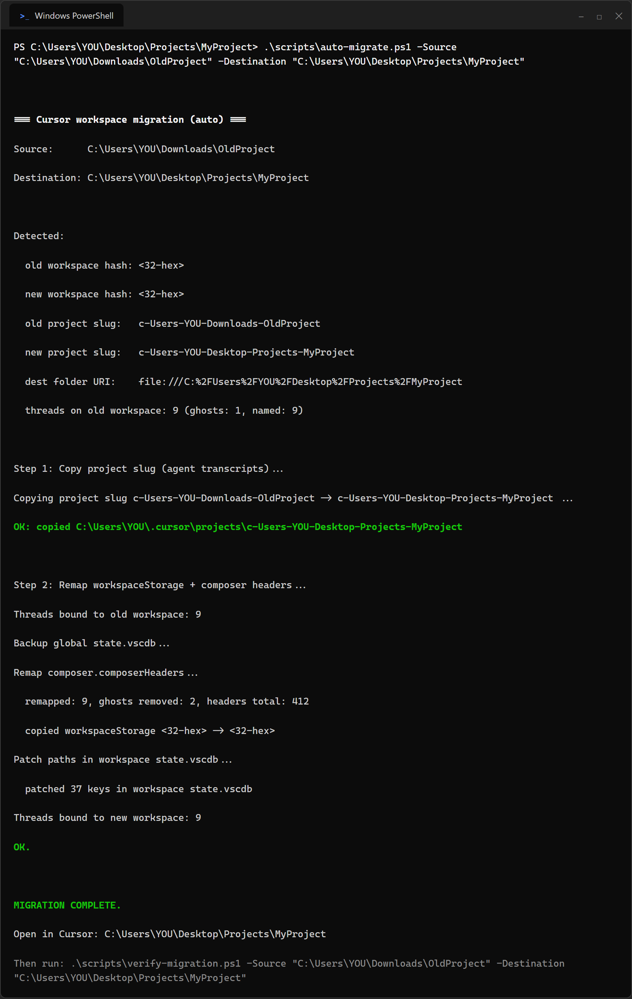
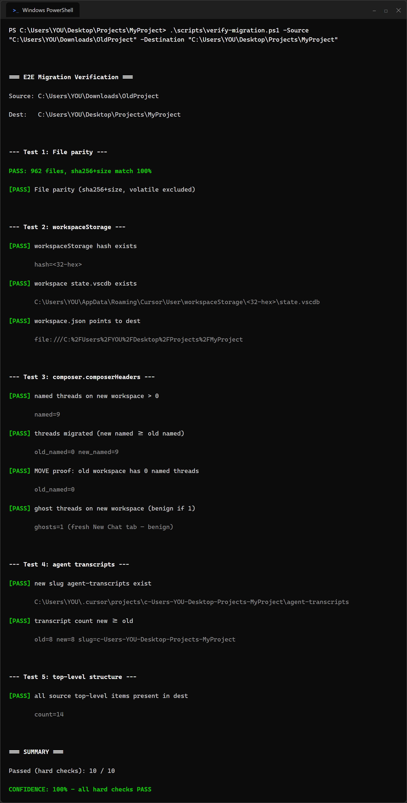
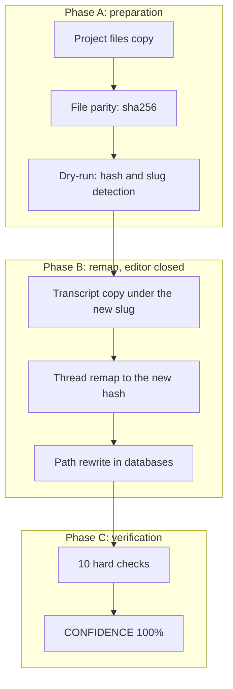

<p align="center"><a href="README.md">Polski</a> | <b>English</b></p>

<p align="center"></p>
<p align="center"><sub>Demo run on sample data (dry-run, migration, E2E verification)</sub></p>

<!-- Previous hero (backup, static):
<p align="center"></p>
-->

<h1 align="center">Cursor project move</h1>

<h3 align="center">Move a Cursor project folder to a new path. Agent chats, thread titles, and transcripts come along.</h3>

<p align="center">
  
  
  
  
  
</p>

---

## Table of contents

- [About](#about)
- [Screenshots](#screenshots)
- [Source code](#source-code)
- [Stack](#stack)
- [Features](#features)
- [Architecture](#architecture)
- [Statistics](#statistics)
- [Contact](#contact)

---

## About

Moving a developer project to another place on disk looks simple: copy, paste, done. In the Cursor editor, copying files is only half the job. The AI chat list in the new location opens empty, and thread titles are gone. The commit history survives; the history of working with the agent, often weeks of fine-tuned context, does not.

This tool moves all four places where the editor keeps project data: the files themselves, chat transcripts, the sidebar state, and the global registry of thread titles. Before touching anything, it shows a read-only plan. Every write is preceded by a timestamped backup. At the end, verification runs: ten hard checks confirm that files match by checksum, threads sit on the new workspace, and nothing is left on the old one.

Case study from the docs: a project of 962 files and 211 MB, nine named threads, eight transcript files. After the move, the old workspace has zero threads, the new one has all nine. Verification: 10/10 checks, CONFIDENCE 100%. The code is public under the MIT license.

---

## Screenshots

| Move plan: detected identifiers and threads, zero writes | File check: 962 files, checksums match 100% |
|:---:|:---:|
|  |  |

| Thread remap: 9 moved, 2 empty tabs removed | Final verification: 10/10 checks, CONFIDENCE 100% |
|:---:|:---:|
|  |  |

> **Note:** the frames are terminal mockups with fictional paths and hashes. Layout and messages match the scripts' output 1:1; the numbers come from the case study in the docs.

---

## Source code

The code is open: [cursor-workspace-migration](https://github.com/kamilkaczmareksolutions/cursor-workspace-migration) (MIT). This repo is a showcase: description, architecture, and frames from a migration.

---

## Stack

### Migration scripts

```
PowerShell 5.1+            // hash and slug detection, transcript copy, verification
Python 3.9+ (stdlib only)  // SQLite database remap, zero pip
SQLite (state.vscdb)       // workspaceStorage and the global composer.composerHeaders registry
robocopy                   // project tree copy
```

### Verification

```
parity-check.ps1           // sha256 + size manifest per file
verify-migration.ps1       // 10 hard checks, CONFIDENCE score
count-threads.py           // thread and empty-tab counter per workspace
```

### Agent-assisted mode

```
Cursor skill + subagent    // guided migration in phases A/B/C
docs/RUNBOOK.md            // runbook with an anonymized case study
```

---

## Features

- **Automatic detection** - the tool finds workspace identifiers in the editor's files on its own. No manual hash hunting in databases
- **Dry run** - a full migration plan without a single write. You see the detected identifiers and thread count before anything changes
- **Move, not copy** - threads land on the new workspace, the old one ends up empty. No duplicated chats in the list
- **Empty tab cleanup** - threads without a title, ghosts of a freshly opened folder, disappear from the chat list
- **Backup before every write** - a timestamped backup is created automatically. Rolling back means restoring a file
- **Final verification with a score** - ten hard checks after the migration. A 100% result only when all of them pass
- **Agent-assisted mode** - an AI assistant runs the migration in three phases following the runbook. A human closes the editor only for the database remap

---

## Architecture



---

## Statistics

### Case study from the docs (June 2026)

| Metric | Value |
|---|---|
| **Project files** | 962 (211 MB) |
| **Named threads** | 9 moved, 0 left on the old workspace |
| **Transcript files** | 8 |
| **Empty tabs removed** | 2 |
| **Verification** | 10/10 hard checks, CONFIDENCE 100% |

### Technical complexity

| Metric | Value |
|---|---|
| **Scripts** | 9 (6 PowerShell, 3 Python), 1,306 lines |
| **Files in repo** | 19 |
| **Python dependencies** | standard library only |
| **Requirements** | Windows, PowerShell 5.1+, Python 3.9+, Cursor >= 2.1.42 |
| **License** | MIT |

### Feature overview

| Category | Highlights |
|---|---|
| **Detection** | workspace hash and project slug without manual work |
| **Safety** | dry-run, timestamped backups, rollback from a file |
| **Move** | 4 data layers, MOVE without duplicates, empty-tab cleanup |
| **Verification** | sha256 parity, 10 hard checks, score |

---

## Contact

| Platform | Link |
|---|---|
| **WWW** | [kamilkaczmareksolutions.com](https://kamilkaczmareksolutions.com) |
| **GitHub** | [kamilkaczmareksolutions](https://github.com/kamilkaczmareksolutions) |
| **LinkedIn** | [Kamil Kaczmarek](https://www.linkedin.com/in/kamilkaczmareksolutions) |
| **Email** | [recruitment@kamilkaczmareksolutions.com](mailto:recruitment@kamilkaczmareksolutions.com) |

---

**Cursor project move** - a new path, the same chat history.

<p align="center"><em>Built by <a href="https://github.com/kamilkaczmareksolutions">Kamil Kaczmarek</a></em></p>
