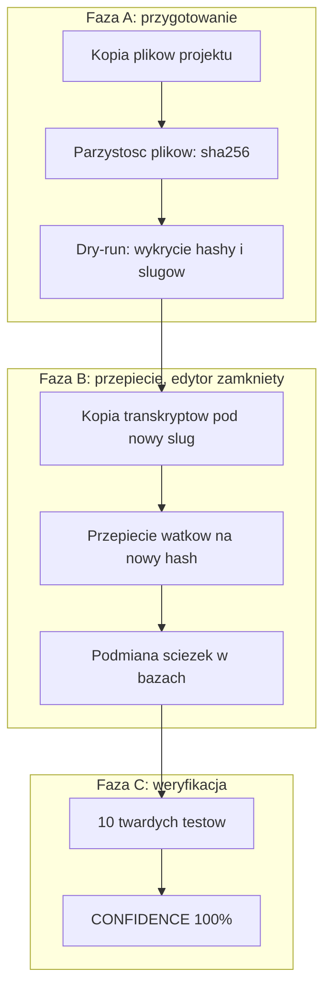

<p align="center"></p>

<h1 align="center">Przenoszenie projektu Cursor</h1>

<h3 align="center">Przenosisz folder projektu na nową ścieżkę. Rozmowy z agentem AI, ich tytuły i transkrypty zostają.</h3>

<p align="center">
  
  
  
  
  
</p>

---

## Spis treści

- [O projekcie](#o-projekcie)
- [Screenshoty](#screenshoty)
- [Kod źródłowy](#kod-źródłowy)
- [Stack](#stack)
- [Funkcje](#funkcje)
- [Architektura](#architektura)
- [Statystyki](#statystyki)
- [Kontakt](#kontakt)

---

## O projekcie

Przeniesienie projektu programisty w inne miejsce na dysku wygląda na prostą sprawę: kopiuj, wklej, gotowe. W edytorze Cursor kopia plików to dopiero połowa roboty. Lista rozmów z asystentem AI w nowej lokalizacji otwiera się pusta, a tytuły wątków znikają. Zostaje historia commitów, ginie historia pracy z agentem, często tygodnie dopieszczonego kontekstu.

To narzędzie przenosi wszystkie cztery miejsca, w których edytor trzyma dane projektu: same pliki, transkrypty rozmów, zawartość panelu bocznego i globalny rejestr tytułów wątków. Przed ruszeniem czegokolwiek pokazuje plan w trybie tylko do odczytu. Każdy zapis poprzedza kopia zapasowa z datą i godziną. Na końcu działa weryfikacja: dziesięć twardych testów sprawdza, że pliki zgadzają się sumami kontrolnymi, wątki siedzą na nowym miejscu, a na starym nie zostało nic.

Case study z dokumentacji: projekt o 962 plikach i 211 MB, dziewięć nazwanych wątków, osiem plików transkryptów. Po przeniesieniu stary workspace ma zero wątków, nowy ma wszystkie dziewięć. Weryfikacja: 10/10 testów, wynik CONFIDENCE 100%. Kod jest publiczny na licencji MIT.

---

## Screenshoty

| Plan przeniesienia: wykryte identyfikatory i wątki, zero zapisu | Kontrola plików: 962 pliki, sumy kontrolne zgodne w 100% |
|:---:|:---:|
|  |  |

| Przepięcie wątków: 9 przeniesionych, 2 puste zakładki usunięte | Weryfikacja końcowa: 10/10 testów, CONFIDENCE 100% |
|:---:|:---:|
|  |  |

> **Nota:** kadry to makiety terminala z fikcyjnymi ścieżkami i hashami. Układ i komunikaty odpowiadają 1:1 wyjściu skryptów, liczby pochodzą z case study w dokumentacji.

---

## Kod źródłowy

Kod jest otwarty: [cursor-workspace-migration](https://github.com/kamilkaczmareksolutions/cursor-workspace-migration) (MIT). To repo to wizytówka: opis, architektura i kadry z migracji.

---

## Stack

### Skrypty migracyjne

```
PowerShell 5.1+            // detekcja hashy i slugów, kopia transkryptów, weryfikacja
Python 3.9+ (tylko stdlib) // przepięcie baz SQLite, zero pip
SQLite (state.vscdb)       // workspaceStorage i globalny rejestr composer.composerHeaders
robocopy                   // kopia drzewa projektu
```

### Weryfikacja

```
parity-check.ps1           // manifest sha256 + rozmiar per plik
verify-migration.ps1       // 10 twardych testów, score CONFIDENCE
count-threads.py           // licznik wątków i pustych zakładek per workspace
```

### Tryb agentowy

```
skill + subagent Cursora   // prowadzenie migracji w fazach A/B/C
docs/RUNBOOK.md            // runbook z anonimizowanym case study
```

---

## Funkcje

- **Automatyczna detekcja** - narzędzie samo znajduje identyfikatory workspace w plikach edytora. Bez ręcznego wyszukiwania hashy w bazach
- **Suchy przebieg** - pełny plan migracji bez jednego zapisu. Widzisz wykryte identyfikatory i liczbę wątków, zanim cokolwiek się zmieni
- **Przeniesienie, nie kopia** - wątki lądują na nowym workspace, stary zostaje pusty. Zero zduplikowanych rozmów na liście
- **Sprzątanie pustych zakładek** - wątki bez tytułu, duchy po świeżo otwartym folderze, znikają z listy rozmów
- **Kopie zapasowe przed każdym zapisem** - backup z datą i godziną powstaje automatycznie. Cofnięcie migracji to przywrócenie pliku
- **Weryfikacja końcowa ze score** - dziesięć twardych testów po migracji. Wynik 100% tylko wtedy, gdy przechodzą wszystkie
- **Tryb agentowy** - asystent AI prowadzi migrację w trzech fazach według runbooka. Człowiek zamyka edytor tylko na czas przepięcia baz

---

## Architektura



---

## Statystyki

### Case study z dokumentacji (czerwiec 2026)

| Metryka | Wartość |
|---|---|
| **Pliki projektu** | 962 (211 MB) |
| **Nazwane wątki** | 9 przeniesionych, 0 na starym workspace |
| **Pliki transkryptów** | 8 |
| **Puste zakładki usunięte** | 2 |
| **Weryfikacja** | 10/10 twardych testów, CONFIDENCE 100% |

### Złożoność techniczna

| Metryka | Wartość |
|---|---|
| **Skrypty** | 9 (6 PowerShell, 3 Python), 1306 linii |
| **Pliki w repo** | 19 |
| **Zależności Pythona** | tylko biblioteka standardowa |
| **Wymagania** | Windows, PowerShell 5.1+, Python 3.9+, Cursor >= 2.1.42 |
| **Licencja** | MIT |

### Przegląd funkcji

| Kategoria | Najważniejsze |
|---|---|
| **Detekcja** | hash workspace i slug projektu bez ręcznej pracy |
| **Bezpieczeństwo** | dry-run, backupy z timestampem, rollback z pliku |
| **Przeniesienie** | 4 warstwy danych, MOVE bez duplikatów, sprzątanie pustych zakładek |
| **Weryfikacja** | parzystość sha256, 10 twardych testów, score |

---

## Kontakt

| Platforma | Link |
|---|---|
| **WWW** | [kamilkaczmareksolutions.com](https://kamilkaczmareksolutions.com) |
| **GitHub** | [kamilkaczmareksolutions](https://github.com/kamilkaczmareksolutions) |
| **LinkedIn** | [Kamil Kaczmarek](https://www.linkedin.com/in/kamilkaczmareksolutions) |
| **Email** | [recruitment@kamilkaczmareksolutions.com](mailto:recruitment@kamilkaczmareksolutions.com) |

---

**Przenoszenie projektu Cursor** - nowa ścieżka, ta sama historia rozmów.

<p align="center"><em>Zbudował <a href="https://github.com/kamilkaczmareksolutions">Kamil Kaczmarek</a></em></p>
